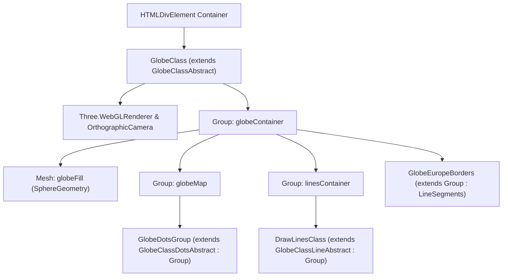

# Architettura e Trattazione Matematica del Componente Three.js Globe

Questo documento fornisce una guida dettagliata e approfondita all'implementazione del componente **Globe 3D** presente nella cartella [`components/three/globe`](file:///home/spola_kg/Scrivania/globe_three_component/components/three/globe).
Il componente, ispirato al celebre globo interattivo di **Stripe**, implementa un rendering WebGL ad altissime prestazioni combinando l'architettura a oggetti (OOP) in TypeScript con Three.js, primitive grafiche unificate in un'unica `BufferGeometry`, custom shader GLSL eseguiti sulla GPU e complesse formule di geometria sferica, geodesica e fisica dell'inerzia.

---

## Mappa Architetturale dei File

La cartella è organizzata separando definizioni astratte, implementazioni concrete e utility matematiche:

```
components/three/globe/
├── GlobeTypes.ts             # Interfacce TypeScript, definizioni dei tipi e stati di caricamento
├── GlobeConfig.ts            # Flag di configurazione (densità, statico, debug, confini europei, frequenza archi)
├── GlobeHelpers.ts           # Costanti matematiche, curve di easing, coordinate paesi, geodesica P()
├── GlobeClassAbstract.ts     # Classe astratta base del coordinatore (Renderer, Camera, Scene, Group)
├── GlobeClass.ts             # Orchestratore del ciclo di vita WebGL, loop di rendering, input ed eventi
├── GlobeClassDotsAbstract.ts # Classe astratta estesa da Three.Group per la nuvola di punti
├── GlobeClassDots.ts         # Generazione punti su sfera di Fibonacci, maschera 2D Canvas e Shader GLSL
├── GlobeClassLineAbstract.ts # Classe astratta estesa da Three.Group per gli archi di collegamento
├── GlobeClassLine.ts         # Archi di Bézier 3D, TubeGeometry, cerchi di approdo e Shader di scorrimento
├── GlobeEuropeBorders.ts     # Vettorizzazione 3D dei confini europei da GeoJSON (LineSegments batched)
├── DrawLinesClass.ts         # Implementazione alternativa standalone di GlobeClassLine
└── index.ts                  # Entrypoint del modulo

public/globe/
└── europe.geojson            # Dati vettoriali dei confini poligonali dei 51 stati europei
```

---

## 1. Architettura delle Classi e Flusso di Esecuzione (Lifecycle)

Il sistema adotta un pattern a livelli basato su classi astratte che estendono `Group` di Three.js:



### Ciclo di Vita del Componente

1. **Istanziazione (`new GlobeClass(element)`):**
   * Invoca `super(element)` che definisce le proprietà reattive, la dimensione del raggio sfera in base allo schermo:
     $$\text{globeRadius} = \min(\text{clientWidth}, 1080) \cdot 0.3 + 250$$
   * Chiama `initializeInteractionEvents()` per fare il bind degli handler di mouse, touch, drag e resize.
2. **Caricamento (`globe.load()`):**
   * Configura il `WebGLRenderer` con `devicePixelRatio`, `setClearColor` e `sortObjects = false`.
   * Configura le luci di scena (`AmbientLight` e 2 `PointLight`).
   * Configura la gerarchia dei contenitori (`globeContainer`, `globeMap`, `linesContainer`).
   * Istanzia `GlobeDotsGroup` che avvia il caricamento asincrono della texture mappa (`globemap.png`).
   * Aggiunge la sfera di sfondo `globeFill` (inizialmente trasparente con opacità 0).
   * Configura la `OrthographicCamera` e registra i listener DOM.
3. **Avvio (`globe.play()`):**
   * Se non statico, genera o programma la creazione ciclica degli archi (`addLines()`, `drawLines()`).
   * Avvia il rendering loop (`this.render(0)`) basato su `requestAnimationFrame`.

---

## 2. Creazione della Sfera e Scena 3D

### A. Camera Ortografica vs Prospettica
Invece di una `PerspectiveCamera`, il componente adotta una `OrthographicCamera`:
```typescript
this.camera = new OrthographicCamera(
  -aspectRatio * windowH * 0.5, // left
   aspectRatio * windowH * 0.5, // right
   0.5 * windowH,               // top
  -0.5 * windowH,               // bottom
  -4 * this.globeRadius,        // near
   4 * this.globeRadius         // far
);
```
**Perché l'Ortografica?**
Una proiezione ortografica elimina la deformazione prospettica (gli oggetti non rimpiccioliscono allontanandosi), offrendo il classico stile visuale "isometrico / flat 2.5D" tipico dell'identità visiva di Stripe. La camera viene poi traslata di:
$$X = -1.05 \cdot R, \quad Y = 0.2 \cdot R$$
per allineare e decentrare armoniosamente il globo nell'area visibile.

### B. Illuminazione a Tre Punti
La scena definisce:
* `AmbientLight(0x99e5fc, 1)`: luce d'ambiente soffusa per evitare ombre completamente nere.
* `PointLight 1` a $(-1000, -1100, -3300)$: luce di controluce dal basso.
* `PointLight 2` a $(-3000, 3000, 3300)$: luce frontale-superiore ad alta intensità per far brillare il materiale della sfera sottostante.

### C. La Sfera di Profondità (`globeFill`)
Costruita tramite `SphereGeometry(globeRadius - 0.1, globeSegments, globeSegments)` e `MeshLambertMaterial`.
* Il raggio è inferiore di $0.1\text{px}$ rispetto ai punti della terraferma, posizionandosi esattamente sotto di essi.
* La sua opacità parte da $0$ e durante la fase di reveal aumenta con la funzione `easeOutQuart` fino a $0.94$, creando un contrasto scuro uniforme sotto i nodi ed evitando che si vedano i punti del lato opposto della terra.

---

## 3. Generazione della Terraferma e Custom Shader (`GlobeClassDots.ts`)

Questa fase converte una mappa $2\text{D}$ piana in centinaia di migliaia di vertici $3\text{D}$ raggruppati in una sola `BufferGeometry`.

### A. Distribuzione Uniforme sulla Sfera (Spirale Sferica di Fibonacci)
Se distribuissimo i nodi campionando uniformemente latitudine e longitudine, si verificherebbe un addensamento innaturale verso i poli. Il componente calcola invece le coordinate sferiche con l'algoritmo della spirale di Fibonacci:

Per ogni indice $i$ da $N$ a $0$ (con $N \approx 76.000$ nodi totali):
1. **Angolo Polare ($\phi$):**
   $$\phi = \arccos\left(\frac{2i}{N} - 1\right) \quad \in [0, \pi]$$
2. **Angolo Azimutale ($\theta$):**
   $$\theta = \sqrt{N \cdot \pi} \cdot \phi$$
3. **Conversione in Spazio Cartesiano 3D:**
   Tramite `vector3.setFromSphericalCoords(radius, phi, theta)`:
   $$X = R \cdot \sin(\phi) \cdot \sin(\theta), \quad Y = R \cdot \cos(\phi), \quad Z = R \cdot \sin(\phi) \cdot \cos(\theta)$$

### B. Campionamento della Maschera 2D (`globemap.png`)
Per ogni punto 3D generato, bisogna decidere se corrisponde a terra o mare:
1. `globemap.png` viene disegnata in un `<canvas>` $2\text{D}$ in memoria e ne viene estratto il buffer `ImageData`.
2. Si esegue la **proiezione inversa da 3D a UV** tramite `getDotCoords()`:
   * Vettore normale normalizzato: $\vec{v} = \text{normalize}(\vec{P}_{\text{local}} - \vec{P}_{\text{bound}})$
   * Coordinata $U$ (longitudine normalizzata in $[0, 1]$):
     $$U = 1 - \left(0.5 + \frac{\text{atan2}(v_z, v_x)}{2\pi}\right)$$
   * Coordinata $V$ (latitudine normalizzata in $[0, 1]$):
     $$V = 0.5 + \frac{\arcsin(v_y)}{\pi}$$
3. Si campiona l'indice nel buffer dei pixel:
   $$\text{index} = 4 \cdot (\lfloor U \cdot W \rfloor + \lfloor V \cdot H \rfloor \cdot W)$$
   Se `imageData.data[index + 3] > 0` (pixel bianco della terraferma con Alpha $> 0$), il punto appartiene a una terra emersa e viene accettato.

### C. Generazione di Dischetti Esagonali e Ottimizzazione `BufferGeometry`
Per ogni punto accettato:
* Viene istanziato un poligono piano `CircleGeometry(smallRadiusPart, 6)`.
* Viene orientato verso l'esterno con `.lookAt(vector3)` e posizionato con `.translate(vector3.x, vector3.y, vector3.z)`.
* I vertici dei 6 triangoli che formano il dischetto vengono uniti negli array raw `r` (coordinate $X, Y, Z$) e `h` (un valore casuale unico $rndId \in [0, 1]$ per ciascun dischetto).
* A fine generazione, tutto confluisce in una singola `BufferGeometry`:
  ```typescript
  bufferGeometry.setAttribute('position', new Float32BufferAttribute(this.r, 3));
  bufferGeometry.setAttribute('rndId', new Float32BufferAttribute(this.h, 1));
  ```
  In questo modo la GPU esegue **un'unica Draw Call** per renderizzare oltre 300.000 triangoli a 60 FPS senza sovraccaricare la CPU.

### D. Custom Shader GLSL dei Nodi

#### Vertex Shader
Il vertex shader calcola la posizione finale del vertice ed esegue un'ondulazione radiale durante il drag dell'utente:
```glsl
uniform float u_time;
uniform float u_drag_time;
uniform vec2 u_resolution;
attribute float rndId;
varying float vRndId;
varying float pct;

void main() {
  vRndId = rndId;
  
  // Percentuale di completamento dell'animazione di ingresso del nodo
  pct = min(1.0, u_time / (1000. / max(0.2, 0.2 * sin(fract(rndId)))));
  
  float vNormal = rndId + ((1.0 - rndId));
  vNormal = smoothstep(0., 1.0, vNormal);
  
  // Se l'utente sta trascinando il globo, genera un'onda sinusoidale di pressione
  if (u_drag_time > 0.) {
    vNormal -= ((sin(u_time / 400.0 * vRndId) + 1.0) * 0.02) * min(1., u_drag_time / 1200.0);
  }
  
  vec4 modelViewPosition = modelViewMatrix * vec4(position, vNormal);
  gl_Position = projectionMatrix * modelViewPosition;
}
```

#### Fragment Shader
Il fragment shader calcola la luminosità pulsante (*twinkle effect*) e il viraggio cromatico dinamico durante il trascinamento:
```glsl
uniform bool u_dragging;
uniform float u_time;
uniform float u_drag_time;
varying float vRndId;
varying float pct;

void main() {
  // 1. Luccichio pulsante (twinkle) indipendente per ogni nodo
  float v = sin(u_time / 200.0 * vRndId);
  float alpha = pct * 0.7 + v * 0.2;

  // 2. Colore di base RGB (es. Blu = [0.19, 0.41, 0.65])
  float r = 0.19;
  float g = 0.41;
  float b = 0.65;

  float dragDur = 1200.0;
  vec3 color = vec3(r, g, b);

  // 3. Variazione cromatica durante il drag
  float rInc = min(1.0, u_drag_time / dragDur) * (sin(u_drag_time / (dragDur * 0.5) + 1.0) * 0.1);
  float gInc = min(1.0, u_drag_time / dragDur) * (sin(u_drag_time / (dragDur * 0.75) - 1.0) * 0.1);
  float bInc = min(1.0, u_drag_time / dragDur) * (sin(u_drag_time / dragDur) * 0.1);

  if (u_dragging) {
    color.r = r + rInc;
    color.g = g + gInc;
    color.b = b + bInc;
  }

  gl_FragColor = vec4(color, alpha);
}
```

---

## 4. Città, Connessioni Geodetiche e Archi 3D (`GlobeClassLine.ts` / `GlobeHelpers.ts`)

Questa sezione implementa la connessione ad arco tridimensionale tra due nazioni.

### A. Conversione da Lat/Lng a Coordinate Vettoriali 3D
La funzione `coordsToVector3D(lat, lng, radius)` mappa latitudine e longitudine su una sfera Three.js:
$$\theta = (90^\circ - \text{lat}) \cdot \frac{\pi}{180}, \quad \phi = \text{lng} \cdot \frac{\pi}{180}$$
$$X = -R \cdot \sin(\theta) \cdot \cos(\phi)$$
$$Y = R \cdot \cos(\theta)$$
$$Z = R \cdot \sin(\theta) \cdot \sin(\phi)$$

### B. Geodesica di Grande Cerchio (Funzione `P()` in `GlobeHelpers.ts`)
Per calcolare la traiettoria più breve tra due città che segue la curvatura terrestre:
1. Calcola la distanza angolare geodetica tra due coordinate $(\text{lng}_1, \text{lat}_1)$ e $(\text{lng}_2, \text{lat}_2)$:
   $$p = \sqrt{\sin^2\left(\frac{\Delta\text{lat}}{2}\right) \cdot \Delta\text{lat} + \cos(\text{lat}_1)\cos(\text{lat}_2)\sin^2\left(\frac{\Delta\text{lng}}{2}\right) \cdot \Delta\text{lng}}$$
   $$\text{distance} = 2 \cdot \arcsin(p)$$
2. La funzione restituisce una closure `fn(t)` che calcola il punto geodetico a una percentuale arbitraria $t \in [0, 1]$ lungo il grande cerchio:
   $$i = \frac{\sin(t \cdot \text{distance})}{\sin(\text{distance})}, \quad e = \frac{\sin(\text{distance} - t \cdot \text{distance})}{\sin(\text{distance})}$$
   Interpolando le componenti trigonometriche per riottenere latitudine e longitudine intermedie.

### C. Costruzione della Curva di Bézier Cubica 3D (`CubicBezierCurve3`)
Per far decollare l'arco nello spazio e farlo atterrare dolcemente:
1. Si campionano due punti geodetici intermedi: a un quarto ($t = 0.25$) e a tre quarti ($t = 0.75$) del tragitto.
2. Si calcola l'altezza di elevazione (curvatura) in base alla distanza tra le due città:
   $$\text{Clamp} = \text{clamp}(0.5 \cdot \Vert{}\vec{P}_{\text{start}} - \vec{P}_{\text{end}}\Vert{}, 160, 500)$$
3. Si creano i 4 punti di controllo della Bézier:
   * $P_0 = \text{coordsToVector3D}(\text{lat}_1, \text{lng}_1, R)$
   * $P_1 = \text{coordsToVector3D}(\text{lat}_{0.25}, \text{lng}_{0.25}, R + \text{Clamp})$
   * $P_2 = \text{coordsToVector3D}(\text{lat}_{0.75}, \text{lng}_{0.75}, R + \text{Clamp})$
   * $P_3 = \text{coordsToVector3D}(\text{lat}_2, \text{lng}_2, 1.002 \cdot R)$
4. La curva viene estrusa in un cilindro continuo tramite:
   ```typescript
   this.geometry = new TubeGeometry(I, 44, 0.2 + arcRadius / 1200, 8, false);
   ```

### D. Animazione di Tracciamento Progressivo (`drawAnimatedLine`)
L'arco non appare istantaneamente ma cresce con la funzione di easing `easeOutQuart`:
$$e = 1 - \left(1 - \frac{\Delta t}{2500}\right)^4$$
$$\text{count} = \min(3000, \lceil 3000 \cdot e \rceil)$$
$$\text{this.geometry.setDrawRange}(0, \text{count})$$

### E. Flusso della Scia Luminosa (Custom Shader della Linea)
Un gradiente luminoso fluisce continuamente lungo il tubo animando la coordinata UV:
```glsl
// Fragment Shader del tubo
uniform float u_time;
uniform sampler2D u_texture;
varying vec2 vUv;
uniform float speedEpsilon; // 0.0004

void main() {
  float ramp = vUv.x * 0.5;
  float pct = fract(ramp - u_time * speedEpsilon); // Scorrimento ciclico
  vec4 color = texture2D(u_texture, vec2(pct, 0.6));
  gl_FragColor = color;
}
```

### F. Cerchietti di Partenza e Arrivo
Due dischi `PlaneGeometry` orientati verso il centro della terra con `.lookAt(0, 0, 0)`:
* Il cerchio di partenza si espande fino a scala $0.35$ all'inizio del tracciamento.
* Il cerchio di arrivo inizia a espandersi quando l'arco supera il $50\%$ del tragitto ($\text{count} > 1500$).
* Durante la scomparsa (`eraseLine()`), entrambi i cerchi si contraggono progressivamente fino al rilascio della memoria (`disposeLine()`).

---

## 5. Tracciamento Vettoriale dei Confini Europei (`GlobeEuropeBorders.ts`)

Per arricchire la rappresentazione geografica mantenendo inalterata la nuvola di punti della terraferma, il modulo `GlobeEuropeBorders` sovrappone i confini politici degli stati europei mediante linee vettoriali sottili (`LineSegments`) ad alte prestazioni.

### A. Parsing e Struttura dei Dati GeoJSON (`europe.geojson`)
I dati geografici dei confini provengono da un GeoJSON vettoriale memorizzato in `public/globe/europe.geojson`. Il file descrive i perimetri dei 51 stati europei tramite geometrie poligonali:
* **`Polygon`**: Singolo anello o sequenza di anelli concentrici (confine esterno ed eventuali enclavi/isole).
* **`MultiPolygon`**: Insieme disgiunto di poligoni per nazioni frammentate (es. isole greche, arcipelago britannico, enclavi).

Ogni anello (LinearRing) è rappresentato da una serie ordinata di coordinate geografiche geodetiche:
$$P_i = [\lambda_i, \phi_i] = [\text{Longitudine}_i, \text{Latitudine}_i]$$

### B. Segmentazione Lineare e Conversione Cartesiana 3D
Per ogni coppia di punti adiacenti $P_i$ e $P_{i+1}$ lungo il perimetro dell'anello poligonale, viene calcolato un segmento di retta tridimensionale nello spazio della sfera:
$$\vec{V}_1 = \text{coordsToVector3D}(\phi_i, \lambda_i, R_{\text{borders}})$$
$$\vec{V}_2 = \text{coordsToVector3D}(\phi_{i+1}, \lambda_{i+1}, R_{\text{borders}})$$

Le coordinate cartesiane corrispondenti sono ricavate tramite:
$$\theta = (90^\circ - \phi) \cdot \frac{\pi}{180}, \quad \psi = \lambda \cdot \frac{\pi}{180}$$
$$X = -R_{\text{borders}} \cdot \sin(\theta) \cdot \cos(\psi)$$
$$Y = R_{\text{borders}} \cdot \cos(\theta)$$
$$Z = R_{\text{borders}} \cdot \sin(\theta) \cdot \sin(\psi)$$

### C. Elevazione Radiale Anti-Z-Fighting
Se i segmenti fossero tracciati esattamente sul raggio $R$ del globo, la coincidenza radiale con i dischi dei nodi della terraferma causerebbe il fenomeno di *Z-Fighting* (sfarfallio e compenetrazione parziale tra vertici complanari).
Per garantire un profilo nitido e continuo, i confini vengono estrusi a una quota radiale leggermente superiore:
$$R_{\text{borders}} = 1.0012 \cdot R_{\text{globe}}$$
Questo scostamento del $+0.12\%$ garantisce che le linee fluttuino impercettibilmente sopra la mesh dei punti, rimanendo sempre visibili da ogni angolo d'inclinazione.

### D. Ottimizzazione delle Prestazioni GPU (Single Draw Call)
Invece di istanziare oggetti `Line` o `Mesh` separati per ogni nazione, tutti i segmenti dell'intero continente europeo vengono accorpati in un unico buffer continuo `Float32BufferAttribute`:
```typescript
const geometry = new BufferGeometry();
geometry.setAttribute('position', new Float32BufferAttribute(vertices, 3));
```
La resa visiva impiega `LineSegments` combinato con `LineBasicMaterial`:
* **Colore**: `#38bdf8` (Azzurro Sky-400, brillante e perfettamente intonato alla palette tech di Stripe).
* **Trasparenza**: `transparent: true`, con opacità nominale `0.65`.
* **Profondità**: `depthWrite: false`, per evitare che la linea scriva nel depth buffer occludendo altri elementi trasparenti retrostanti.
* **Draw Call**: L'intero reticolo dei confini europei richiede **1 sola Draw Call** GPU, con impatto prestazionale praticamente nullo su CPU e GPU.

### E. Sincronizzazione con il Ciclo di Vita del Globo
`GlobeEuropeBorders` estende la classe `Group` di Three.js ed è ancorato direttamente a `this.globeContainer`:
1. **Trasformazioni Spaziali**: Condivide in tempo reale le rotazioni sull'asse $X$ e $Y$, rispondendo al drag manuale dell'utente e all'inerzia fisica (`throwGlobe`).
2. **Reveal Animation**: All'avvio, l'opacità delle linee parte da $0$ e sfuma progressivamente fino al valore a regime mediante la funzione `setOpacity(animationDelta)` sincronizzata con la curva `easeOutQuart`.

---

## 6. Azioni Utente e Fisica dell'Inerzia (`GlobeClass.ts`)

Il componente gestisce interazioni naturali tramite mouse e touch screen con smorzamento inerziale:

### A. Tensione e Resistenza al Drag
Durante il trascinamento (`handleDragging`):
1. **Calcolo della tensione verticale:**
   $$\text{tension} = (1 + |\text{oldRotationX}|)^{(1 + |\text{oldRotationX}|)}$$
   Maggiore è l'inclinazione polare, maggiore è la resistenza al trascinamento, impedendo che il globo si capovolga in modo anomalo.
2. **Delta di spostamento:**
   $$\Delta X = -0.003 \cdot (\text{oldMouseX} - \text{mouseX})$$
   $$\Delta Y = \frac{-0.003 \cdot (\text{oldMouseY} - \text{mouseY})}{\text{tension}}$$
3. **Clamp dell'inclinazione polare (Asse X):**
   La rotazione verticale viene limitata rigorosamente tra $Q = -0.5\pi$ e $B = 0.25\pi$.
4. **Effetto "Scala di Pressione":**
   Durante il drag, il globo si rimpicciolisce leggermente (`targetScale = 0.98`), ritornando a `1.0` al rilascio per dare un feedback tattile tridimensionale.

### B. Inerzia Fisica del Rilascio (`throwGlobe`)
Quando l'utente rilascia il mouse o solleva il dito (`mouseup` / `touchend`), l'ultimo vettore di movimento viene trasmesso a `throwGlobe(moveX, moveY)`:
1. Ad ogni frame, l'impulso residuo subisce uno smorzamento con fattore di attrito del $6\%$:
   $$v_x(t+1) = 0.94 \cdot v_x(t), \quad v_y(t+1) = 0.94 \cdot v_y(t)$$
2. La rotazione $Y$ viene normalizzata nell'intervallo $[0, 2\pi]$ da `resetRevolutions()`:
   $$\text{Rot}_y = \text{Rot}_y - \left\lfloor \frac{|\text{Rot}_y|}{2\pi} \right\rfloor \cdot \text{sign}(\text{Rot}_y) \cdot 2\pi$$
3. Il ciclo ricorsivo continua via `requestAnimationFrame` finché l'energia cinetica scende sotto la soglia di arresto ($|v_x| < 0.001$ e $|v_y| < 0.001$).
4. Terminata l'inerzia, il globo riprende la sua rotazione automatica continua (`autoRotateGlobe()`).

---

## 7. Frequenza, Durata e Configurazione Dinamica degli Archi (`GlobeConfig.ts`)

La generazione degli archi di collegamento non è più rigida ma parametrata centralmente in `GlobeConfig.ts`:

```typescript
export const LINE_INTERVAL_MS: number = 600;   // Frequenza di generazione (intervallo di spawn in ms)
export const LINE_LIFETIME_MS: number = 3000;  // Durata di vita dell'arco prima dell'animazione di riassorbimento
export const LINES_PER_CYCLE: number = 1;      // Quanti archi generare ad ogni tick di intervallo
export const STATIC_LINE_COUNT: number = 8;    // Numero di archi fissi generati se IS_STATIC = true
export const ENABLE_EUROPE_BORDERS: boolean = true; // Attivazione/disattivazione confini europei
```

### Relazione Dinamica Quantità / Frequenza
Il numero medio di archi contemporaneamente visibili a regime sul globo ($\bar{N}_{\text{linee}}$) segue la relazione:
$$\bar{N}_{\text{linee}} = \left\lceil \frac{\text{LINE\_LIFETIME\_MS}}{\text{LINE\_INTERVAL\_MS}} \right\rceil \cdot \text{LINES\_PER\_CYCLE}$$

* **Con i parametri correnti** ($3000\text{ms} / 600\text{ms} \cdot 1$): sul globo sono sempre presenti circa **$5$ archi attivi e visibili** in vari stadi di animazione (espansione, scorrimento scia UV e riassorbimento).
* Modificando questi valori è possibile passare istantaneamente da un look minimale a una visualizzazione ad alto traffico.

---

## 8. Riepilogo Formule Matematiche e Costanti Chiave

| Simbolo / Funzione | Formula / Valore | Ruolo / Scopo |
| :--- | :--- | :--- |
| `ConvToRadia` | $\pi / 180 \approx 0.017453$ | Conversione gradi $\rightarrow$ radianti |
| `ConvToDegree` | $180 / \pi \approx 57.29578$ | Conversione radianti $\rightarrow$ gradi |
| **Fibonacci Polar** $\phi$ | $\arccos\left(\frac{2i}{N} - 1\right)$ | Distribuzione uniforme latitudine sulla sfera |
| **Fibonacci Azimuth** $\theta$ | $\sqrt{N \cdot \pi} \cdot \phi$ | Distribuzione uniforme longitudine sulla sfera |
| **Proiezione Inversa U** | $1 - (0.5 + \text{atan2}(v_z, v_x) / 2\pi)$ | Campionamento ascissa texture 2D della mappa |
| **Proiezione Inversa V** | $0.5 + \arcsin(v_y) / \pi$ | Campionamento ordinata texture 2D della mappa |
| **Distanza Geodetica** | $2 \arcsin\left(\sqrt{\sin^2(\Delta\text{lat}/2) + \dots}\right)$ | Arco di Grande Cerchio tra due città |
| **Bézier Clamp Offset** | $\text{clamp}(0.5 \cdot \|\vec{P}_1 - \vec{P}_2\|, 160, 500)$ | Quota di elevazione radiale dell'arco |
| `R_borders` | $1.0012 \cdot R_{\text{globe}}$ | Quota radiale anti-z-fighting confini europei |
| `easeOutQuart(t)` | $1 - (1 - t)^4$ | Tracciamento progressivo fluido di archi e reveal |
| **Attrito Inerziale** | $v_{t+1} = 0.94 \cdot v_t$ | Smorzamento cinetico al rilascio del globo |
| **Archi a Regime** | $\lceil T_{\text{life}} / T_{\text{interval}} \rceil \cdot K$ | Densità volumetrica di linee contemporanee |

